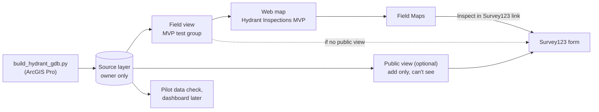

# Hydrant inspection MVP

Set up a hydrant inspection app two ways, in **ArcGIS Field Maps** and in **ArcGIS Survey123**, let SFFD crews try both, then pick one to build out.

Both apps write to the same inspections table, so every inspection lands in one place whichever app the crew used.

- **Target:** ArcGIS Enterprise 11.5, [gis.sfpuc.org/portal](https://gis.sfpuc.org/portal)
- **Scope:** low-pressure hydrants only for now (no AWSS hydrants or cisterns yet)
- **Status:** hydrants and inspections are published (step 1). Views are being set up (step 2), then the web map and pop-ups (steps 3 and 4).

## Latest changes

**2026-10-20**

- **Offline basemap.** The Enterprise gallery basemaps can't go offline. Use an Esri "for Export" basemap added to the portal with stored ArcGIS Online credentials (pilot), or your own vector tile package (citywide). See [Offline basemap](reference/offline-basemap.md).
- **Lower-case field names.** The portal can store field names in lower case (`gisid`). The demo loader and pilot data check now match field names in any case.
- **Demo inspections** to show every pop-up state (never inspected, OK, due, follow-up, not found, low pressure). See [Load demo inspections](setup/04-popups.md#load-demo-inspections).
- **"Features with true curves cannot currently be edited"** in Field Maps is a service setting, not the data. [Fix it here](reference/troubleshooting.md#features-with-true-curves-cannot-currently-be-edited).
- **Crews edit through views, not the published layer.** The source is owner-only; a field view feeds Field Maps; an optional public view takes Survey123 submissions. See [step 2](setup/02-views.md).
- **Keep every field in both views.** Privacy comes from the view settings, not from hiding fields. See [fields in each view](setup/02-views.md#fields-in-each-view).
- **Public view: Add greyed out?** Turn on Add in the source item's Settings first. **Public data collection** goes on for the public view only, with a five-point safety checklist. See [step 2c](setup/02-views.md#2c-create-the-public-view-optional).
- **New pop-up spec** with status banners, short labels, an "Issues found" list and [phone mockups](https://claude.ai/artifact/4VeRmAyeFMtAFJMPuF19c1). See [step 4](setup/04-popups.md).
- **The Survey123 link** is an Arcade element that returns an "Inspect in Survey123" button. See [step 6d](setup/06-survey123.md#6d-add-the-inspect-in-survey123-button).
- **Running the build script:** in a Pro notebook use `%run`; in the Python window use the `runpy` line; `propy` only works in the Python Command Prompt. See [step 1](setup/01-build-data.md).
- **All the separate files are now this one guide.** See [where the old files went](#where-the-old-files-went).

> **About "Check in 11.5" notes.** This guide was written without access to the portal. Where you see **Check in 11.5**, the feature or label couldn't be confirmed for 11.5, so look for it in your UI before relying on it.

## Setup, in order

Work through these top to bottom. Each step says who usually does it and what you should have when it's done.

| Step | What you do | Who | Done when |
|---|---|---|---|
| [1. Build and publish the data](setup/01-build-data.md) | Run the script in ArcGIS Pro, publish one hosted layer | GIS analyst | Hydrants and HydrantInspections are on the portal |
| [2. Lock down the source and create views](setup/02-views.md) | Make the source owner-only, create the field view and (optionally) the public view | GIS analyst | Crews can only reach data through views |
| [3. Build the web map](setup/03-web-map.md) | Map for Field Maps, built on the field view | GIS analyst | `Hydrant Inspections MVP` map is saved and shared |
| [4. Set up pop-ups](setup/04-popups.md) | Hydrant and inspection pop-ups with status banners | GIS analyst | Pop-ups show status at a glance on a phone |
| [5. Build the Field Maps form](setup/05-field-maps-form.md) | Form groups, calculated fields, offline area | GIS analyst | A test inspection saves from Field Maps |
| [6. Publish the Survey123 form](setup/06-survey123.md) | Open the XLSForm in Connect, brand it, publish, add the pop-up link | GIS analyst, portal admin | A test inspection saves from Survey123 |
| [7. Test before the pilot](setup/07-test.md) | Crew-account test, public test, phone tap-test | GIS analyst | Every box on the test checklist is ticked |
| [8. Run the staff pilot](setup/08-pilot.md) | Prep, sessions with SFFD testers, scoring, decision | Pilot team | One app chosen |

## How the pieces fit

## Reference

- [Schema and field reasons](reference/schema.md): every field, its type, and the SFFD report lines it replaces
- [Field Maps vs Survey123](reference/app-comparison.md): how the two forms differ, for the comparison
- [Pilot task cards](reference/task-cards.md): printable Set A and Set B cards
- [Offline basemap](reference/offline-basemap.md): a basemap Field Maps can take offline, and the offline area steps
- [Esri 11.5 documentation](reference/esri-docs.md): links for each step
- [Troubleshooting](reference/troubleshooting.md): fixes for problems found on the portal, starting with the Field Maps true curves warning
- [Downloads](downloads.md): scripts, data, the XLSForm and the pilot scorecard

## Where the old files went

| Old file | Now in |
|---|---|
| `BUILD-GUIDE.md` | Steps [1](setup/01-build-data.md), [5](setup/05-field-maps-form.md), [6](setup/06-survey123.md) and [7](setup/07-test.md) |
| `VIEWS-AND-WEBMAP.md` | Steps [2](setup/02-views.md), [3](setup/03-web-map.md), [6a](setup/06-survey123.md#6a-pick-which-view-the-survey-writes-to) and [7](setup/07-test.md) |
| `FIELD-MAPS-POPUPS.md` | Step [4](setup/04-popups.md) |
| `field-maps-arcade.md` | Form expressions in step [5](setup/05-field-maps-form.md#5b-calculated-fields); Survey123 button in step [6d](setup/06-survey123.md#6d-add-the-inspect-in-survey123-button) |
| `pilot/PILOT-SCRIPT.md` | Step [8](setup/08-pilot.md) and the [task cards](reference/task-cards.md) |
| `hydrant-inspection-schema-draft.md` | [Schema and field reasons](reference/schema.md) |
| `DOWNLOADS.md` | [Downloads](downloads.md) |

## Making changes

This repo is now the one place to edit the guide. Change a page under `docs/`, add a line to **Latest changes** above, and merge. Claude can do this through a pull request when you ask in the project.

> **Internal use.** This site holds the portal address, service names, SFFD inspector names and SFPUC logos. Keep the repo private and share it by adding people as collaborators.
