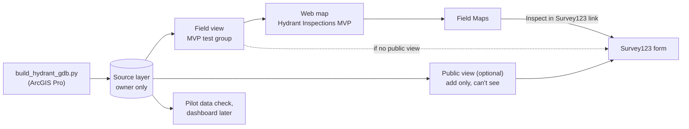

# Hydrant inspection MVP

Set up a hydrant inspection app two ways, in **ArcGIS Field Maps** and in **ArcGIS Survey123**, let SFFD crews try both, then pick one to build out.

Both apps write to the same inspections table, so every inspection lands in one place whichever app the crew used.

- **Target:** ArcGIS Enterprise 11.5, [gis.sfpuc.org/portal](https://gis.sfpuc.org/portal)
- **Scope:** low-pressure hydrants only for now (no AWSS hydrants or cisterns yet)
- **Status:** hydrants and inspections are published to the portal. Next up: views and the web map (step 2).

## Latest changes

**2026-10-20**

- **Offline basemap.** The Enterprise gallery basemaps can't go offline. Use an Esri "for Export" basemap added to the portal with stored ArcGIS Online credentials (pilot), or your own vector tile package (citywide). See [Offline basemap](reference/offline-basemap.md).

> **About "Check in 11.5" notes.** This guide was written without access to the portal. Where you see **Check in 11.5**, the feature or label couldn't be confirmed for 11.5, so look for it in your UI before relying on it.

## Setup, in order

Work through these top to bottom. Each step says who usually does it and what you should have when it's done.

| Step | What you do | Who | Done when |
|---|---|---|---|
| [1. Build and publish the data](setup/01-build-data.md) | Run the script in ArcGIS Pro, publish one hosted layer | GIS analyst | Hydrants and HydrantInspections are on the portal |
| [2. Lock down the source and create views](setup/02-views.md) | Make the source owner-only, create the field view and (optionally) the public view | GIS analyst | Crews can only reach data through views |
| [3. Build the web map](setup/03-web-map.md) | Map for Field Maps, built on the field view | GIS analyst | `Hydrant Inspections MVP` map is saved and shared |
| [4. Set up pop-ups](setup/04-popups.md) | Hydrant and inspection pop-ups with status banners | GIS analyst | Pop-ups show status at a glance on a phone |
| [5. Build the Field Maps form](setup/05-field-maps-form.md) | Form groups, calculated fields, offline area | GIS analyst | A test inspection saves from Field Maps |
| [6. Publish the Survey123 form](setup/06-survey123.md) | Open the XLSForm in Connect, brand it, publish, add the pop-up link | GIS analyst, portal admin | A test inspection saves from Survey123 |
| [7. Test before the pilot](setup/07-test.md) | Crew-account test, public test, phone tap-test | GIS analyst | Every box on the test checklist is ticked |
| [8. Run the staff pilot](setup/08-pilot.md) | Prep, sessions with SFFD testers, scoring, decision | Pilot team | One app chosen |

## How the pieces fit

## Reference

- [Schema and field reasons](reference/schema.md): every field, its type, and the SFFD report lines it replaces
- [Field Maps vs Survey123](reference/app-comparison.md): how the two forms differ, for the comparison
- [Pilot task cards](reference/task-cards.md): printable Set A and Set B cards
- [Offline basemap](reference/offline-basemap.md): a basemap Field Maps can take offline, and the offline area steps
- [Esri 11.5 documentation](reference/esri-docs.md): links for each step
- [Downloads](downloads.md): scripts, data, the XLSForm and the pilot scorecard

> **Internal use.** This site holds the portal address, service names, SFFD inspector names and SFPUC logos. Keep the repo private and share it by adding people as collaborators.
